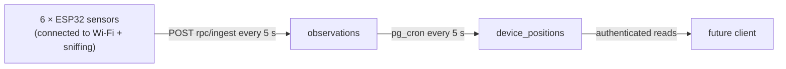

# terium v2: Implementation Plan

A personal passion project. **Keep it small:** as few files, tables and lines of code as reasonably possible, while staying easy to read and extend. When in doubt, choose the simpler option and note the alternative in a code comment or README line rather than building it.

The agent works inside `terium_sensor/`, which becomes the git repository. Don't touch anything outside it.

---

## 1. What we're building

ESP32 sensors around a house sniff Wi-Fi frames from nearby phones. Every 5 s they send one HTTPS request to Supabase containing the signal strength of each device they heard. Every 5 s a Postgres function turns the recent readings into a 3D position per device. A future client app, which is out of scope, will read the positions.



## 2. Decisions

| Topic | Decision |
|---|---|
| Rust code | **One crate**: the firmware, at the repo root. No workspace, no shared library. |
| Hardware | Classic ESP32, mains-powered, 2.4 GHz only. |
| Radio | Stay connected to Wi-Fi as a station **and** sniff in promiscuous mode. Never switch to `WIFI_MODE_NULL`, never hop channels, and turn power save **off**. |
| What's sniffed | Set by one database flag, `site_config.scan_all_devices` (§4.3). The default `false` keeps devices on our own mesh: their data frames, and their probe requests. |
| Privacy | Send the real device MAC as 12 hex characters. No hash and no daily rotation, so the same phone stays the same id across days and a client can remember it. Fine for this personal project: the POST is HTTPS, writes need the sensor key, reads need a logged-in user. The MAC is stored, and it also lands in the API gateway log (§8), which cannot be turned off. |
| Backend | Supabase **Free** plan, a new organisation, region **London**. The **user** creates the project. |
| Ingest | One Data API RPC call per sensor every 5 s. No Edge Functions. |
| Positioning | Postgres function on a 5-second Supabase Cron job. 3D only. A device needs **≥ 4 sensors** with known positions to be positioned. |
| Auth | Sensors share one secret key, sent in a header. Reads require a logged-in Supabase user. |
| Sensor identity | Derived from each board's MAC (`esp-<12 hex>`), so **one firmware build serves every sensor**. Unknown sensors register themselves on first contact. |
| Layout | Sensor positions and site bounds live only in the database. Rearranging sensors, including a 3-up / 3-down layout, is an `UPDATE`. Nothing about the layout is compiled in. |

## 3. Repository layout

```
terium_sensor/
├── PLAN.md
├── README.md              # setup, flashing, registering sensors, the toggle, read API, privacy
├── .gitignore             # target/, .embuild/, cfg.toml, legacy-2024/, .env*, supabase/.temp
├── Cargo.toml, Cargo.lock, build.rs, sdkconfig.defaults, rust-toolchain.toml, .cargo/config.toml
├── cfg.toml.example       # shared by all sensors; the real cfg.toml is gitignored
├── src/
│   ├── main.rs            # setup + main loop (aggregate, upload, housekeeping)
│   ├── wifi.rs            # connect, reconnect, SNTP
│   ├── sniffer.rs         # promiscuous callback + 802.11 parsing (pure functions)
│   └── upload.rs          # JSON, HTTPS POST
├── supabase/              # created by `supabase init`
│   ├── migrations/        # ideally a single schema migration
│   └── tests/positions.sql
└── legacy-2024/           # the old 2024 files, gitignored and kept locally for reference only
```

## 4. Firmware

### 4.1 Config (`cfg.toml` via `toml-cfg`)

The Wi-Fi and Supabase values are the same on every sensor. `log_serial` is the one key you change per board.

`wifi_ssid`, `wifi_psk`, `supabase_url`, `supabase_key` (the publishable key), `sensor_key` (the shared ingest secret), `log_serial` (default `false`).

`log_serial` is the USB log switch. It is read at boot from `cfg.toml`, so turning it on means editing that file and reflashing the one board you have plugged in. Leave it false on every sensor that is just mounted on a wall. The normal image prints nothing to serial. With it true, the 60-second line in §4.2 is printed and the ESP-IDF log level is raised to info. `sdkconfig.defaults` sets the default IDF log level to none, so a normal boot is quiet too. A panic still prints; that path is not optional.

Constants in `main.rs`. These are firmware build settings. Changing one means rebuilding and reflashing. Sensor positions are not in this list; they are rows in `sensors` (§7).

| Constant                  | Value  | What it controls                                                                                                                                                                                                                                                                                           |
| ------------------------- | ------ | ---------------------------------------------------------------------------------------------------------------------------------------------------------------------------------------------------------------------------------------------------------------------------------------------------------- |
| `UPLOAD_INTERVAL`         | 5 s    | How often each sensor sends one HTTPS request. It does not change how often frames are sniffed. It only batches the readings gathered since the last successful upload. Five seconds is the freshness we want; the cost is request volume (§8).                                                            |
| `SLOT`                    | 2 s    | How long a burst of frames from one device is collapsed into a single reading. `slot` is the unix time rounded down to a multiple of 2. A phone streaming video can send hundreds of frames in that window; we store one RSSI, the median. This is what limits database rows. Upload interval does not. |
| `MAX_READINGS`            | 2000   | Most distinct `(device, slot)` pairs held in RAM waiting for a successful upload. Past this, further devices are skipped until the upload succeeds and the map is cleared. It stops a failed upload, or a huge crowd of phones, from growing memory without bound.                                         |
| `MAX_LOCAL_APS`           | 8      | Most mesh access points remembered from beacons advertising our SSID, plus the AP we are associated with. A house mesh is a handful of nodes. 8 is a safety cap so a neighbour's lookalike traffic, or a bug, cannot grow the set forever. The associated BSSID is always kept.                            |
| `MAX_LOCAL_DEVICES`       | 64     | Most phone MACs remembered because we have seen them on our network (§4.3). Same idea as the AP cap: enough for a house, bounded so it cannot grow without limit. When full, the oldest entry is dropped.                                                                                                  |
| `LOCAL_DEVICE_TTL`        | 10 min | How long a remembered phone stays "on our network" after we last saw it send a data frame to our mesh, or a probe request naming our SSID. After that it is forgotten, so a guest who left does not stay in the default scan forever.                                                                      |
| `RESTART_AFTER_NO_UPLOAD` | 10 min | If every upload has failed for this long, reboot the board. This recovers a wedged Wi-Fi or TLS stack. Shorter blips just retry on the next interval.                                                                                                                                                      |

### 4.2 Behaviour

1. **Boot:**
   - Connect Wi-Fi as a station.
   - Turn power save off (`esp_wifi_set_ps(WIFI_PS_NONE)`). Otherwise the radio sleeps between beacons and misses frames.
   - Wait for SNTP time sync. Both TLS and the timestamps need it.
   - Read the station MAC, which gives `sensor_id = "esp-" + hex(mac)`.
   - Enable promiscuous mode with the filter `MGMT | DATA`.
2. **Callback** (runs in the Wi-Fi driver task, so keep it tiny: no allocation, no logging):
   - Parse the frame with a pure function in `sniffer.rs` (§4.3).
   - Convert RSSI with `raw as u8 as i8`. The ESP binding doesn't sign-extend, so 196 means −60 dBm.
   - `try_send` a small `Copy` event into a `std::sync::mpsc::sync_channel(1024)`.
   - If the channel is full, increment an `AtomicU32` drop counter.
3. **Main loop.** Receive events with a timeout up to the next upload deadline:
   - `Beacon` whose SSID equals `wifi_ssid`: add its BSSID to `local_aps` (capped at `MAX_LOCAL_APS`). The associated BSSID is always included. This discovers **mesh nodes automatically**.
   - `Data` / `Probe`: decide whether this frame is from our network, then keep one RSSI for it.
     - A **data** frame addressed to one of our mesh APs means that phone is on our network. Remember its MAC (`local_devices`, capped and expired as in §4.1) and keep the frame.
     - A **data** frame addressed to some other network is ignored in the default mode. All-devices mode keeps it and does not remember the MAC.
     - A **probe request** is kept in the default mode when it is from a phone we already remember, or when the probe itself names our SSID (a phone looking for our network, which is how a phone sitting on the 5 GHz radio still shows up). Remember that MAC too. Any other probe is ignored in the default mode and kept in all-devices mode.
     - A kept frame increments a 100-bin histogram for `readings[(mac, slot)]`, where `slot = unix_secs / 2 * 2`. Bins are one dBm from −100 to −1. Other strengths are ignored, because ingest rejects them. When the slot closes, the uploaded value is the median: the middle frame, or the nearest dBm to the mean of the two middle frames, with a halfway result rounding weaker. One phone in one 2-second slot is one entry. Stop adding new entries when `MAX_READINGS` is reached. A closed slot keeps only that median, so a failed upload does not hold the counts.
4. **Upload** (every 5 s):
   - Send only **finished** slots (the 2-second window has ended). The slot still in progress stays in memory, so later frames still join its median until the window closes. Five seconds is not a multiple of two, so an upload will usually contain two finished slots and leave one open.
   - `POST {supabase_url}/rest/v1/rpc/ingest` (§4.4) over TLS using ESP-IDF's certificate bundle.
   - **On success:** drop the slots just sent and apply the returned `scan_all_devices`.
   - **On failure:** keep them and retry next interval. The cap bounds memory. Sending the same slot twice is harmless because the table's primary key ignores the duplicate.
5. **Housekeeping:**
   - Reconnect Wi-Fi if it drops.
   - Restart the board if there has been no successful upload for 10 min.
   - Keep the counters below updated either way. When `log_serial` is true, print them as one line every 60 s. When it is false, print nothing.
     - **events/s** — frames that made it out of the sniffer callback into the main loop during that minute. Zero means the sniffer is silent.
     - **drops** — frames thrown away because the channel between the callback and the main loop was full. Climbing means the loop is not keeping up.
     - **readings held** — `(device, slot)` entries waiting to upload. It should stay small. A number stuck near `MAX_READINGS` means uploads are failing.
     - **local APs** — mesh nodes currently remembered. After a minute on the network this should be every 2.4 GHz node you expect, and the same set on every sensor.
     - **local devices** — phones currently remembered as on our network. This is the set whose probe requests the default mode keeps.
     - **channel** — the Wi-Fi channel this sensor is associated on. All sensors should show the same number. If they don't, the mesh is splitting 2.4 GHz across channels and each sensor sees a different slice of traffic.
     - **free heap** — bytes of free RAM. It should sit still across hours. A steady fall is a leak.

### 4.3 Frame parsing and the scan filter

Read the header from the byte slice, never by casting to a struct. Ignore frames shorter than 24 bytes. Byte 0 of the frame control field holds type (bits 2–3) and subtype (bits 4–7); byte 1 holds ToDS (bit 0) and FromDS (bit 1).

| Frame | Event |
|---|---|
| Management, subtype 4 (probe request) | `Probe { mac: addr2, ssid_matches }`. Tagged elements start at byte 24. The SSID element is ID 0. |
| Management, subtype 8 (beacon) | `Beacon { bssid: addr3, ssid_matches }`. The SSID element (ID 0) starts at byte 36, after the 12 fixed beacon bytes. |
| Data (type 2), ToDS = 1, FromDS = 0 (phone → AP) | `Data { mac: addr2, bssid: addr1 }` |
| Anything else (AP → phone, mesh backhaul, etc.) | ignored |

Drop any frame whose `mac` is multicast, is our own MAC, or is in `local_aps`.

| | `scan_all_devices = false` (default) | `true` |
|---|---|---|
| Data to a local AP | keep, and remember the MAC | keep, and remember the MAC |
| Data to another network | drop | keep, don't remember the MAC |
| Probe that names our SSID, or comes from a remembered MAC | keep, and remember the MAC | keep |
| Any other probe | drop | keep |

The default stays local-only because unconnected phones pick a new random MAC for every probe burst, roughly once a minute, so those probes cannot be followed. Connected phones keep a stable per-network MAC and use it both in data frames and in probe requests, so once a data frame (or a probe naming our SSID) has introduced them, later probes from that phone are part of the same device.

### 4.4 Wire format

The request headers are `apikey: <publishable key>` (check current Supabase docs for the exact publishable-key headers), `x-sensor-key: <sensor_key>`, and `Content-Type: application/json`.

```json
{
  "sensor_id": "esp-a1b2c3d4e5f6",
  "readings": [
    { "device": "3a7bd3e2360a", "ts": 1762354800, "rssi": -52 }
  ]
}
```

- `device` is the MAC as 12 lowercase hex characters, no separators. The same bytes every day, so a client can store "this id is Rory's phone" and have it match tomorrow.
- A phone joined to this network already uses one private address for this SSID, and that address is what we send. It stays put across days until the phone itself rotates it or the network is forgotten. Phones that are not on our network still pick a fresh random MAC for each probe burst (§4.3), so those still will not line up tomorrow. That part is the phone, not our id.
- There is no `self_hash`. A sensor's own station MAC is the 12 hex characters in its `sensor_id`, and other sensors hear that MAC in its frames. The backend skips any `device` for which `esp-<device>` is a row in `sensors`.
- The response is `{ "scan_all_devices": false }`.

## 5. Backend (Supabase)

### 5.1 Schema (one migration)

All tables are in `public` with RLS enabled.

| Table | Columns | Reads |
|---|---|---|
| `site_config` | `id int pk check (id = 1)`, `scan_all_devices bool default false`, `x_min, x_max, y_min, y_max, z_min, z_max real` | `authenticated` |
| `sensors` | `id text pk`, `x, y, z real null` (null means not placed yet, so ignored), `ref_rssi real default -45` (RSSI at 1 m), `path_loss real default 2.5`, `last_seen_at timestamptz` | `authenticated` |
| `observations` | `ts timestamptz`, `sensor_id text`, `device_mac text`, `rssi smallint`; `primary key (ts, sensor_id, device_mac)` | none |
| `device_positions` | `device_mac text pk`, `x, y, z real`, `error_m real`, `updated_at timestamptz` | `authenticated` |
| `private.secret` | `key_sha256 text` (one row) | none (private schema) |

No policies give `anon` any table access. Sensors write only through the RPC.

### 5.2 Ingest

- `**public.ingest(sensor_id text, readings jsonb) returns jsonb**` is `security invoker`. It just calls `private.ingest(...)`.
- `**private.ingest**` is `security definer`, with `set search_path = ''`. It lives in the non-exposed `private` schema, following the Supabase rule that `security definer` functions must not be exposed. Grant `anon` `USAGE` on `private` and `EXECUTE` on this one function. It:
  1. Compares `sha256(current_setting('request.headers', true)::json ->> 'x-sensor-key')` with `private.secret`. On a mismatch it raises an error that PostgREST maps to 401/403 (check the docs).
  2. Upserts `sensors (id, last_seen_at = now())`. New sensors appear with null positions. `device` values are stored as `device_mac`.
  3. Inserts readings with `jsonb_to_recordset`, `on conflict do nothing`. It drops rows with RSSI outside −100..−1 or `ts` more than 5 min from `now()`, and caps the insert at 2000 rows.
  4. Returns `{"scan_all_devices": …}`.

### 5.3 Positioning: `private.compute_positions()`, every 5 s via pg_cron

1. For each `(device_mac, sensor)` with readings in the last 5 s, take `avg(rssi)`. Use only sensors with a position, and skip any `device_mac` that belongs to a sensor (`'esp-' || device_mac = sensors.id`).
2. Keep devices heard by **≥ 4 sensors**. Convert each average to a distance: `d = 10 ^ ((ref_rssi - rssi) / (10 * path_loss))`, clamped to 0.3–25 m.
3. `**private.solve(xs, ys, zs, ds real[])` returns `(x, y, z, error_m)`.** It's a small, separately testable function using weighted Gauss–Newton (weights `1/d²`) with 3×3 normal equations solved by Cramer's rule, for at most 10 iterations. The function must not `RAISE NOTICE` or `RAISE LOG`; it runs every 5 s and each notice becomes log ingest (§8).
   - Start at the weighted centroid of the sensors.
   - **Clamp every iterate to the `site_config` bounds.** With most sensors near floor level, an unclamped solve can land on a mirror-image point below the floor.
   - `error_m` is the RMS of the distance residuals.
4. Upsert `device_positions`.
5. Housekeeping in the same function:
   - delete positions not updated for 1 hr;
   - delete observations older than 1 h;
   - delete `cron.job_run_details` rows older than 1 h, which otherwise grow forever.

### 5.4 Reads

A future client uses the standard Data API with a user JWT: `device_positions`, `sensors` and `site_config`.

Everything you change by hand is a row in the database, written from the SQL editor. No reflash:

```sql
-- mode
update site_config set scan_all_devices = false;  -- or true

-- where the house is, in metres
update site_config set x_min = 0, x_max = 12, y_min = 0, y_max = 10, z_min = 0, z_max = 10;

-- where each sensor actually sits; null x/y/z takes it out of the solve
update sensors set x = 0, y = 0, z = 1 where id = 'esp-...';
```

### 5.5 Seed and tests

- `supabase/seed.sql` (local only) contains the bounds `x 0–12, y 0–10, z 0–10`, a test secret, and the six example positions from §7. Production sensors register themselves with null coordinates; you place them with the SQL in §7.
- `supabase/tests/positions.sql` (pgTAP):
  - `private.solve` recovers a downstairs point (6, 5, 1) and an upstairs point (6, 5, 6) to within 0.1 m from ideal distances, using the §7 example, and never returns z < 0.
  - `ingest` rejects a wrong key, accepts the right one, and returns the flag.

## 6. Steps

The user creates the Supabase project only after this plan has been executed. Do every step that runs locally (setup, the migration, `supabase test db`, firmware, README) without a linked project, and do not stop to ask for a project ref. Step 3 is the one that needs the project. Leave it for a later pass.

1. **Set up.**
   - Move the existing 2024 files into `legacy-2024/`: `src/`, `archive/`, `Cargo.*`, `build.rs`, `sdkconfig.defaults`, `.cargo/`. It's gitignored, so the old credentials are never committed.
   - Delete `target/` and `.embuild/`.
   - Scaffold a fresh std project at the root from the **current** `esp-idf-template`. Use the current `esp-idf-svc` and ESP-IDF versions, and set `ESP_IDF_TOOLS_INSTALL_DIR = "global"`.
   - Write `.gitignore` and make the first commit.
2. **Backend, locally.** `supabase init`, then write the migration, seed and test. `supabase test db` must pass, and the advisors must show no security warnings.
3. **Deploy.** Deferred. The project does not exist yet, and it will not be created during this execution. When the user has created it afterwards:
   - `supabase link` and `supabase db push`, then schedule the cron job.
   - Set the real secret hash, insert the `site_config` bounds, and create one test user.
   - Turn off every Supabase log we are allowed to (§8). The API gateway log cannot be turned off.
4. **Firmware.**
   - Implement §4. `cargo build --release` must succeed and clippy must be clean.
   - The user flashes the boards. All six use the same image and appear in `sensors` on their own.
   - The user writes each sensor's measured `x, y, z` with the SQL in §5.4. Moving a sensor later is the same `UPDATE`.
   - With `log_serial` on for the board under test, check the serial line. Then confirm rows are arriving. Flash the wall image with `log_serial` false.
5. **Check and calibrate.**
   - Walk a phone around and confirm its position follows you.
   - Confirm every sensor's channel is the same, by flashing one board at a time with `log_serial` on or by reading it from the router. If the mesh nodes use different 2.4 GHz channels, fix the channel in the router.
   - Optionally tune `ref_rssi` and `path_loss` per sensor: hold a phone 1 m from a sensor and read the average RSSI.
   - After 24 h, check the Free-plan usage page (§8).
6. **README.** Cover setup, flashing, placing sensors, the toggle, the read API, the privacy notes (real MACs are stored, and they also appear in the API gateway log) and the known limitations (§7).

## 7. Site and sensors

- **Coordinates:** x is width (0–12 m), y is length (0–10 m), z is height (0–10 m). It's a two-storey house with the upper floor at about z = 5.
- **Where positions live:** only in `sensors` and `site_config`. The firmware binary and the positioning function read those rows at runtime. Rearranging to 3 upstairs and 3 downstairs, shifting one sensor, or taking one out of the solve is the SQL in §5.4. A sensor with null `x`, `y` or `z` is ignored until you place it.
- **Example, not a default.** One way to spread three and three, raised off the floor (about 1 m downstairs, about 6 m upstairs). Replace the coordinates with what you measure, and the ids with the ids the boards register:

```sql
update sensors set x = 0,  y = 0,  z = 1 where id = 'esp-down-1';
update sensors set x = 12, y = 5,  z = 1 where id = 'esp-down-2';
update sensors set x = 0,  y = 10, z = 1 where id = 'esp-down-3';
update sensors set x = 12, y = 0,  z = 6 where id = 'esp-up-1';
update sensors set x = 0,  y = 5,  z = 6 where id = 'esp-up-2';
update sensors set x = 12, y = 10, z = 6 where id = 'esp-up-3';
```

The local seed and the position test use these numbers. Production does not.

- **Limitations to document:**
  - The floor between storeys weakens signals in a way the distance model doesn't capture, so z is the least reliable axis. Treat `z > 5` as "upstairs" rather than as an exact height.
  - Three and three covers both floors. A floor left with fewer than three sensors will be rougher. Adding or moving a sensor is a flash (same image) plus an `UPDATE`.
  - Expect accuracy of a few metres.
  - A phone associated only on 5 GHz sends no 2.4 GHz data frames. The default mode still sees it when it probe-requests our SSID on 2.4 GHz. Broadcast probes from a phone we have never seen are ignored until all-devices mode is on.

## 8. Free-plan budget

**The API gateway log cannot be turned off.** Every request to Supabase, including `ingest`, is written as an `edge_logs` entry. There is no project setting to sample or disable it (still true as of Nov 2026). That is the log volume we are stuck with.

Everything else gets turned off on deploy:

- **pg_cron.** `cron.log_statement` defaults to **on**, which would write a Postgres log line every 5 s. Set it to `false` with `supabase postgres-config update` (`--config cron.log_statement=false`). This restarts the database for a few seconds. pg_cron still writes `cron.job_run_details`; there is no off switch for that table, so `compute_positions` keeps deleting those rows. That table is ours, not the platform log meter.
- **Statement logging.** For the `anon`, `authenticated`, `authenticator`, `service_role` and `postgres` roles: `log_statement = none`, `log_duration = off`, `log_min_duration_statement = -1` (which means off, not "log slow queries"), `log_lock_waits = off`. Then `NOTIFY pgrst, 'reload config'`.
- **Messages.** `log_min_messages = error` on those same roles, and no `RAISE NOTICE` or `RAISE LOG` anywhere in our functions. Errors still get through, so a broken `ingest` is visible. `log_checkpoints`, `log_connections` and `log_disconnections` off via the same postgres-config command.
- **PostgREST.** Leave its log level at the default, `error`, which does not record successful requests. Don't raise it. If `postgrest_logs` is showing every ingest, set the level back to `error` or `crit` using whatever `pgrst` setting the current docs list.
- **Don't enable pgAudit.**

The included Free quota is **1 GB of log ingest per month** (checked Nov 2026). Overage on Free is not billed. If it continues, Supabase can restrict the project (failed API calls, a read-only database, or pausing). Organisations that already existed in September 2026 have a grace period through early 2027 before that is enforced. A new organisation has the same grace period for now, but Supabase has said it may end sooner for new organisations.

Six sensors uploading every 5 s is about **3.1 million requests a month**. At a few hundred bytes of API-gateway log per request that is already around or above 1 GB, and turning the other logs off does not shrink this part. If the usage page after 24 h is heading past 1 GB, raise `UPLOAD_INTERVAL` and reflash.

Deleting stored logs does not refill the meter. Supabase counts bytes ingested during the month. On the Free plan, API and database logs already expire after 1 day.

Database size is a separate quota (500 MB) and is fine: one row per device per sensor per 2 s, kept for 1 h, is a few tens of MB. Egress is negligible. Free projects pause after a week of inactivity. Constant sensor traffic should prevent that; confirm in step 5.

## 9. Pitfalls (from the 2024 code)

- Calling `esp_wifi_set_mode(WIFI_MODE_NULL)` to sniff disconnects Wi-Fi. Don't.
- Don't share a `static mut` between the callback and the main loop. Use the channel.
- Don't log or allocate in the callback.
- Bounds-check every frame. **Any panic reboots the board**, so never `unwrap()` network or parse results.
- RSSI sign: `raw as u8 as i8`.
- Never commit `cfg.toml`.

## 10. Later, if wanted (not now)

Realtime push to a client · OTA updates · more upstairs sensors or a simple floor classifier · hiding static devices (TVs, plugs) · an ESP32-C5 for 5 GHz.
