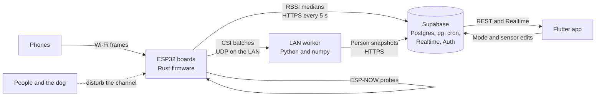

# Terium

**Wi-Fi sensing for a real house.** Cheap ESP32 boards around my two-storey house locate phones from their Wi-Fi signal strength. They are also being taught to detect people, and the dog, from how a body disturbs the Wi-Fi passing between the boards. It needs no cameras, no wearables and no app on the phones being tracked.

Terium covers the whole stack: embedded Rust firmware, a Postgres backend that does the positioning maths, a signal-processing worker on the home network, and a cross-platform Flutter app (specified, and next to be built). It's built for one house and one owner, but engineered the way I'd want any system to be: small, tested, documented, and honest about what it can't do yet.

## Highlights

- **Detecting people with nothing on them.** In Person mode the boards take turns broadcasting ESP-NOW probes, each in its own 20 ms slot. Every other board captures the probe's channel state information (CSI), which records how the signal arrived across each subcarrier after bouncing around the house. A body changes that pattern. A Python worker compares every link with an empty-house reference, matches the change against templates recorded at measured spots in each room, and publishes anonymous `(x, y, z)` detections for people and the dog.
- **Two sensing modes, one fleet, switched from the database.** Changing one column in Postgres makes every board change what it captures on its next exchange, with no reflashing. Each board acknowledges the config version it has applied, so a switch shows as pending until the whole fleet has caught up. Results captured before a switch are never shown as current.
- **Trilateration in SQL.** Device mode's solver is a weighted Gauss–Newton least-squares fit written in PL/pgSQL, which pg_cron runs every 5 seconds. It declines to answer when the geometry can't support one: a closed-form eigenvalue of the sensors' spread rejects layouts too flat to tell a point from its mirror image. It publishes nothing rather than a confident wrong answer.
- **One firmware, two CPU architectures.** The Rust firmware runs on ESP-IDF and builds from a single crate for both the classic ESP32 (Xtensa, 2.4 GHz) and the ESP32-C5 (RISC-V, 5 GHz). Every chip- and band-specific detail sits behind one module. The boards stay connected to the home Wi-Fi while sniffing in promiscuous mode, parse 802.11 frames themselves, and reduce what they hear to per-device RSSI medians.
- **Models tied to the physical layout.** Each set of sensor positions hashes to a layout id. If a sensor moves, Person mode asks for recalibration. If it moves back, the old model applies again automatically.
- **Record once, replay forever.** Calibration sessions are recorded raw. Live inference, training and replay all use the same pipeline, so a change to the processing can be measured against old recordings before it goes live.
- **Designed around a free tier.** Everything runs on the Supabase Free plan. Upload intervals and publish rates were chosen from a monthly budget of requests against the plan's log allowance.
- **Secure and private by default.** Boards and the worker authenticate with a shared secret that the database only ever compares as a SHA-256 digest. Row-level security and column-level grants define exactly what the app can read and edit. By default the boards keep only phones that are on, or looking for, the home network. Raw sightings are deleted after an hour and positions after a week. CSI never leaves the home network, and person detections carry no identity.
- **Tested where it matters.** pgTAP tests cover the schema, permissions and mode switching. Rust unit tests, run on the host machine, cover the 802.11 parser, the RSSI medians and the CSI batch format. Python tests run the worker against a simulated house. Supabase's security advisor runs as one of the checks.

## How it works



- **Device mode** (the default). Each board reports the median signal strength of every phone it hears, every 5 seconds. Postgres turns those readings into distances and solves for each phone's position. The app shows each phone's last fix, live.
- **Person mode.** The boards probe each other and stream CSI to the worker. The worker keeps a single live snapshot of detections in Supabase, with no history.

## Tech stack

| Layer | Technology |
| --- | --- |
| Hardware | Classic ESP32 boards (Xtensa, 2.4 GHz) today. Eight Waveshare ESP32-C5-Zero boards (RISC-V, dual-band Wi-Fi 6) are on the way. The worker runs on an always-on computer on the home network. |
| Firmware | Rust on ESP-IDF v6.0.3 through `esp-idf-svc`, using Wi-Fi promiscuous mode, ESP-NOW and the CSI API |
| Backend | Supabase: Postgres 17, PL/pgSQL, pg_cron, PostgREST, Realtime, Auth and row-level security, tested with pgTAP |
| Worker | Python 3 and numpy |
| App (next) | Flutter and Dart for Android, macOS and the web, with Riverpod, go_router and `supabase_flutter` |

## Repository layout

```
terium_sensor/   firmware, Supabase backend and the Person-mode worker
terium_app/      the app's specification (the app itself is next)
```

- [`terium_sensor/README.md`](terium_sensor/README.md) covers building and flashing, the local checks, calibrating both modes, setting up the worker and the contract the app uses.
- [`terium_app/App Specification.md`](terium_app/App%20Specification.md) defines the app: what it does and doesn't do, its screens, the API it uses and its definition of done.

## Status

| Part | State |
| --- | --- |
| Device mode | The RSSI tracker has run on six classic ESP32 boards. The two-mode version is built and passes its tests locally, and is ready to flash. |
| Person mode | Probes, CSI capture, recording, training, replay and publishing are built and tested against a simulated house. Next is a calibration walk-through on the real boards. |
| ESP32-C5 | The firmware builds for the C5. Bring-up starts when the boards arrive. |
| App | Fully specified, including the API contract. It's the next thing to build. |

Device-mode positions are accurate to a few metres. Person mode's accuracy on real boards is still unproven. Height is the hardest axis in both modes. The [sensor README](terium_sensor/README.md#status-and-known-limitations) lists every known limitation.

## How it's built

Each stage starts as a written plan with requirements, constraints and a definition of done:

- [the original tracker](terium_sensor/PLAN.md)
- [Device and Person modes](terium_sensor/Indoor%20Tracking%20Implementation%20Plan.md)
- [the app](terium_app/App%20Specification.md)

A stage is finished when its checks pass and its README matches what was built.
